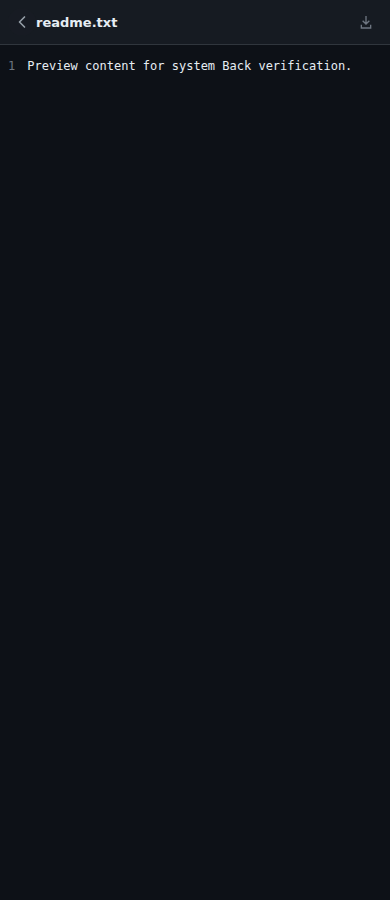
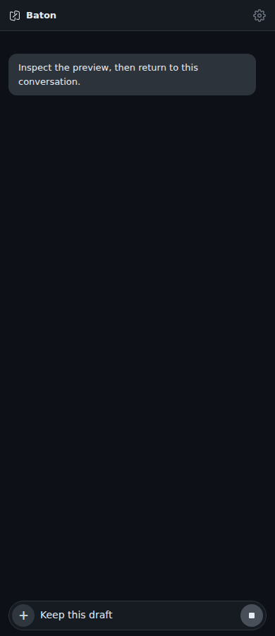

# Android system Back

Baton's in-page device/project/session navigation is stored in JavaScript state.
Android currently falls back to Tauri's WebView-history behavior, which does not
represent that navigation stack. This change connects the system Back action to
the existing Baton close and navigation handlers.

Back is handled in this order:

1. Hide a visible Android keyboard, preserving the focused input and draft.
2. Cancel the current HTML dialog or close the visible modal/image preview.
   A disabled cancellation control consumes Back without navigating underneath.
3. Close the slash-command popup.
4. Close the most recently activated preview/navigation layer.
5. Navigate up through Baton; the setup page uses its existing return handler.
6. At the main page's root, move the task to the background.

The native callback waits for the JavaScript result before accepting another
Back request. A page without the Baton hook delegates to Tauri's existing
handler. In particular, the landing page keeps its existing QR-scanner Back
listener. An exception inside the page handler consumes the event rather than
unexpectedly leaving the app.

The existing application edge-swipe gesture remains available. This does not
change app identity, signing configuration, themes, keyboard layout/inset
calculations, or Bridge/Server code.

## Example

| File preview | After Back |
| --- | --- |
|  |  |

These are actual 390px Chromium screenshots with synthetic conversation/file
data. The test invokes the same page callback called by Android. It exercises
the product file viewer and navigation, but is not a physical-device screenshot.

## Validation

- Full frontend suite: 610 passed, one existing native-rename skip.
- Eight focused cases cover layer order, modal cancellation, disabled controls,
  image/thread dialogs, native dialog cancellation, hidden ancestors, command
  popup priority, root/page routing and registration cleanup.
- Real Chromium at 390px and 1180px: file/image/modal dismissal, preserved draft,
  session → sessions → projects → home, root return, setup → home and no overflow.
- Packaging checks: 31 passed. Vite production frontend build passed.
- Full ARM64 Android debug APK built with Tauri 2.11.1, compile/target SDK 36 and
  minimum SDK 24. The Kotlin callback compiled, the APK signature verified using
  a disposable test signer, and both the native hook and current frontend
  modules were confirmed in the package. The test APK was not installed.

Device acceptance remains: three-button Back and completed system Back gestures,
keyboard dismissal without page navigation, repeated presses, rotating/resuming
the app, modal/file/image dismissal, root background/reopen, and QR scan
cancellation. Predictive gesture animation has not been separately validated.
The PR stays draft until those native interactions are checked.
