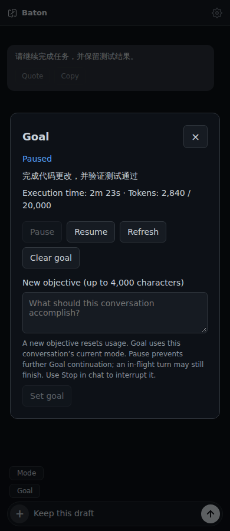
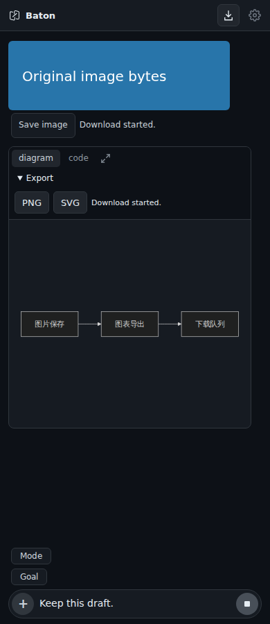
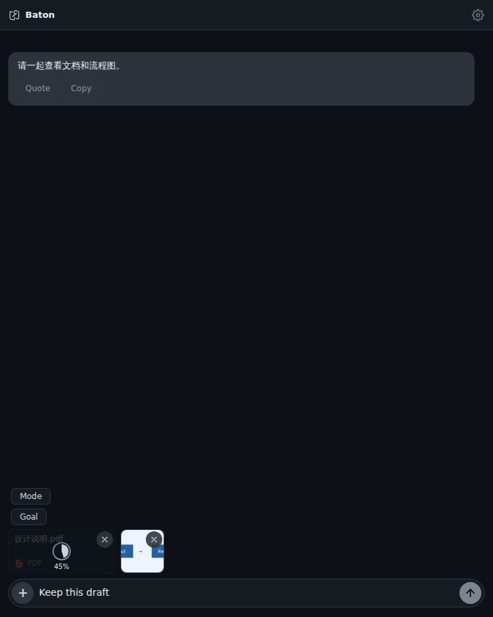

# Pending contributions: combined verification

This branch combines fourteen open contribution PRs so their interactions and conflict resolutions can be inspected together. The individual PRs remain the review/merge units. This is not a release, an installed application, or a claim that the maintainer has accepted the changes.

Base: `283dbf62574e0dc10f713b6fb2f9861611204406`.

| PR | Verified source commit |
| --- | --- |
| #92 | `60887f23a6f58d4c92838b7f67bd3114e91dbc04` |
| #93 | `5c9626723329e4ca686b6a4908fe672733baa872` |
| #94 | `cfb0ec94b513d2fdaa8f0dd6411dadc36166bb9c` |
| #95 | `3773e958470fb38626c0b176874abf886891f6cd` |
| #96 | `fcc8f8cd7bf37781fa0ca60591a0269e412651b7` |
| #97 | `729714082c56d8fa623187161ca69e12c26262b6` |
| #98 | `530a33c7ab7b29b155d778d875238ef49589fa70` |
| #99 | `d6ffbe874a0d7d2600670e94eba90f8ec9da04e3` |
| #101 | `c5be34aba2fea2d64e2990b0c5c2e15f12afbee6` |
| #102 | `6844046c62ee9904a5aa7fb04a7e2b7e3860ebec` |
| #103 | `c445a1b0b073c70df6d3e5388f890dfd23dbf569` |
| #104 | `8374face7672cb902406623a81c9bb11018dc7a8` |
| #105 | `49bb390cb883fc7f8122f864154327db7bd6b482` |
| #106 | `ad7e46671c688b0dc497f6d0bc697389f5e40330` |

## Merge resolution

The initial merge order was #92, #93, #95, #103, #104, #96, #101, #94, #99, #105, #102, #97, #98, followed by #106 and the #105 stylesheet fix. Eleven of the initial 78 pairwise combinations had text conflicts; #106 also conflicts with #97, #98 and #102 independently. This branch retains all features in the resolutions.

- `web/js/entry-index.js`: retain each feature import and call each initializer once after the core modules have loaded. Quote, message Copy, code Copy, Goal, Mode, image saving, Back, file drop and zoom all remain enabled.
- `src-tauri/src/lib.rs`: retain drop, zoom and native-tab modules and commands. The other-platform handler keeps explicit unsupported-platform responses. The native-tab window factory also configures drop hooks on every new window/tab.
- `web/js/entry-setup.js`: initialize both native tabs and Android Back. The main entry initializes tabs, drop and zoom once.
- `src-tauri/Cargo.toml`: retain reqwest blocking, objc2/AppKit and Foundation NSString/NSProcessInfo together.
- `src-tauri/Cargo.lock`: regenerate the combined dependency graph. This adds the existing futures-channel/futures-sink dependency edges needed by blocking plus streaming reqwest; no package versions were upgraded.

These resolutions are already present in this branch's merge history. The individual PRs have not been replaced with a single combined PR.

## Verification

- Current fourteen-PR frontend: 708 passed, 1 existing skip. Packaging: 31 passed. Vite build passed. Bridge 324, Codex 117 and Server 145 passed on the preceding thirteen-PR combination; their source is unchanged by the tab integration and stylesheet fix.
- Chromium at 390/1180 px: real clipboard Copy/Quote/code Copy, streaming and history updates, original image bytes, Mermaid PNG/SVG exports, queue cancellation acknowledgement/retry, draft preservation and Back closing the queue before navigation.
- Same-session Mode/Goal checks run through the product frontend, local WebSocket, handlers and CodexInteraction, with a synthetic Codex runtime: Plan/Normal changes preserve the quote draft; Back closes Mode; Goal pause/resume preserves usage and automatic output remains visible. The individual Goal and Mode PRs separately document their real Codex runtime checks.
- Drag/drop at 720/1180 px: real staging and browser image compression with simulated native drag/claim/upload. Duplicate events, session changes, upload progress and draft preservation pass. Zoom shortcut command dispatch during an upload also passes; this is not WKWebView zoom validation.
- A fifth browser suite exercises the actual native-tab/drop/zoom entry bootstrap with simulated Tauri IPC: two-page title isolation, tab creation retry, draft/selection preservation, Settings Back and zoom dispatch during upload. It does not execute AppKit or Finder.
- All five browser suites reported no page errors. Screenshots below are from Chromium using synthetic content, not native device screenshots.
- Visual inspection found that #105's queue stylesheet was not imported. The previous interaction checks missed this. Importing it from the file viewer fixes the layout; an added browser assertion failed before the fix (`static` instead of `fixed`) and passed afterward at 390/1180 px, checking panel position, width and list padding. Both standalone #105 and the combination passed this check; attachment/download focused tests passed 31/31.
- Full Rust application checks passed for `aarch64-apple-darwin` and `aarch64-linux-android` with the locked dependency graph. Mac cross-target checking uses Clang and verifies the real AppKit/Tauri types; it does not link an app bundle or run macOS. Mac/iOS builds and device acceptance remain pending.

A complete ARM64 Android debug APK of the combined implementation built successfully (command exit 0). The disposable test signature, ZIP integrity, native plugin commands, Back hook and current bundled frontend were verified. The APK was not installed; this does not establish native device acceptance.

Verified product source: `ca650764950ce6a35216301b0a22bb123ee6c411`. APK SHA-256: `b43e76d8436a9368f919fe47955a4628f4ec1374e66001f139595533df8f331d`. Later documentation and screenshot changes do not alter that product source.

```sh
npm ci
npm ci --prefix bridge
NODE_OPTIONS=--no-experimental-global-navigator npm run test:frontend
npm run test:bridge
npm run test:codex
python3 -m pytest test/server
npm run test:packaging
npm run build
```







## Remaining scope

Native Mac/iOS builds and actual device saving/sharing/cancellation, Android Back/keyboard/lifecycle and Mac Finder/WKWebView behavior remain separate acceptance gates. Native tabs are included in the code, but real AppKit screenshots, grouping/closing behavior and the optional native tab-strip add button still need Mac verification. Independent whole-window colors await the maintainer's theme interface. Theme work remains deferred to that implementation; the Android keyboard change still needs a current-device reproduction.

Cancellable download preparation needs coordinated frontend, Bridge and Server updates. This branch does not deploy services or replace the existing Baton Lab installation.
