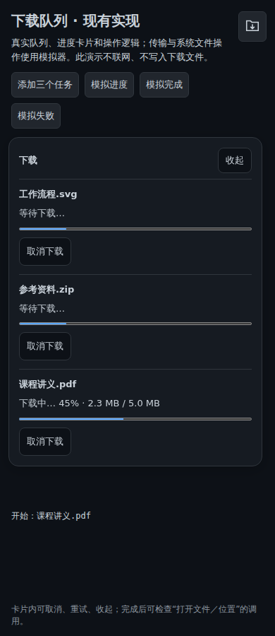
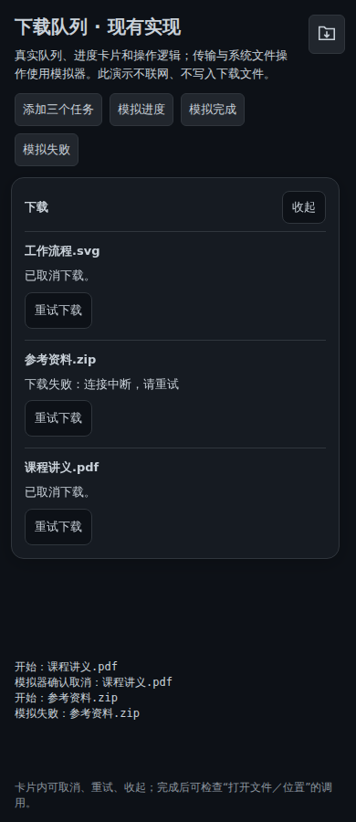
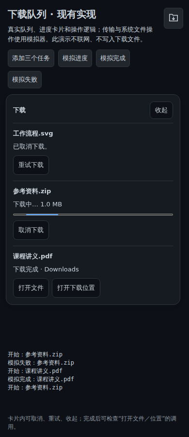

# 下载队列：现有实现供评审

按作者“可以先看下您的实现”的反馈，先提供队列／进度／取消／重试／打开位置的现有实现。本分支只增加参考材料，不改变 Baton 运行代码，也不代表下载队列已经进入正式版。

[下载交互演示与源码参考包](assets/showcase/download-queue/Baton-Download-Queue-Reference.zip)

解压后在包目录运行 `npm ci`、`npm run demo`，打开终端给出的本地地址并加上 `/demo/`。需要 Node.js 24。包内含 README、源码哈希清单、原生插件和测试。

演示使用真实前端队列、下载适配层和状态卡片；**传输及系统文件操作使用模拟器**，不会连接账号或下载文件。下图不是原生系统保存验收。

## 当前可以参考的部分

- 每窗口独立串行队列，排队／传输取消，失败重试排到队尾。
- 百分比与字节进度、未知总量、取消确认及旧回调隔离。
- 持续可查看的任务卡片和保存回执；按回执打开文件／位置。
- 桌面异步传输、超时、部分文件清理、避免覆盖已有文件，以及Android／iOS对应实现。

## 贡献前需要补齐的边界

现有调用固定设备／项目／路径，但没有完整封存服务器和账号；正式移植需固定请求上下文或在切换时取消对应队列。取消准备阶段目前终止客户端等待，Bridge上的打包／上传可能继续，不能称为全链路取消。

参考代码仍使用Lab工具栏／样式和Tauri API 2.12.4；作者主线为2.11.1。正式版入口、版本适配和原生平台验收应随选定方案处理。队列历史只在当前窗口内存中保留。

## 已做验证

参考包前端15项、Linux原生逻辑27项通过。390／1180px Chromium验证排队、进度、取消、重试、回执调用与历史重新打开通过，页面错误为0。解压后的包也通过依赖安装和全部15项前端测试。

原生逻辑测试不等于Mac／Android／iOS真机保存或打开位置已验收。包内保留该区别，供确定采用范围后继续完成独立功能贡献。
