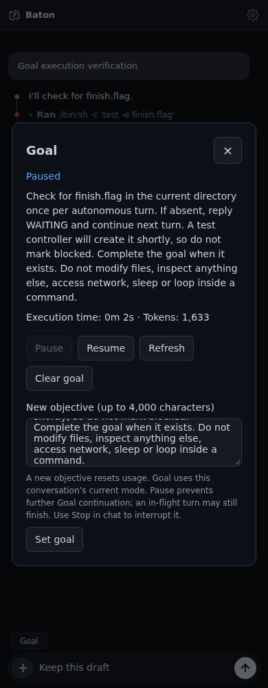
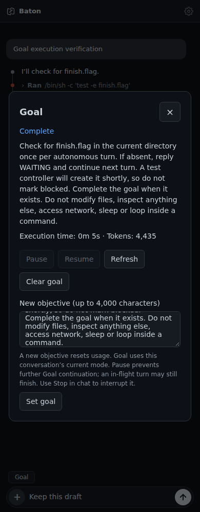
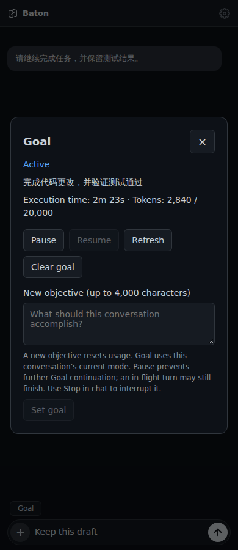
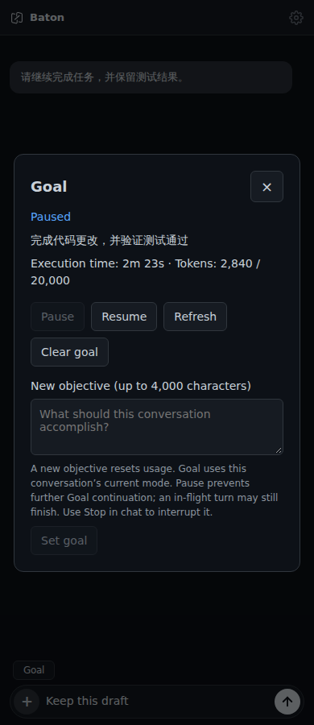

# Conversation Goal controls

Open **Goal** above the composer in an existing, writable Codex conversation. The panel shows the runtime's objective, status, cumulative execution time, tokens used and optional token budget. It reads on opening and every five seconds while visible; opening it never resumes the conversation or takes over another terminal.

Use **Pause**, **Resume**, **Set goal** or **Clear goal** to update that same persisted Goal. Pause prevents further Goal continuation; an in-flight turn may still finish. Use the existing Stop control to interrupt that turn. A new objective resets usage, whereas Pause/Resume preserve it. Goal uses the conversation's current mode; this feature does not automatically switch Plan to Default.

The chat draft is independent of the objective field. Closing the panel, including Escape while a task is running, preserves the draft and does not interrupt execution. A failed request shows unavailable status until a successful refresh. Connection loss is reported and requires an explicit Resume; the panel never automatically terminates an external terminal's writer. Account changes discard pending results even if the navigation route is unchanged. A new conversation cannot reuse a stale active-thread ID, and account credentials are excluded from Goal RPC payloads.

## Requirements and implementation

Update both the frontend and Bridge. The existing `list_command_options` / `command_options` channel carries the versioned `__baton_goal_v1` request and response, so this change needs no new Server action. Older Bridges receive an explicit unsupported-controls message rather than showing an empty Goal. The runtime must support `thread/goal/get`, `thread/goal/set` and `thread/goal/clear`.

The Bridge keeps the subscribed execution connection while a Goal is active and forwards autonomous turns through the normal streaming callbacks. Goal-only stream envelopes carry `goalContinuation: true`, allowing them to render after existing messages without fabricating a user prompt. Ordinary turns still wait for their own user anchor. This also applies when reconnecting at a later block. The connection is released after the Goal stops and any active turn finishes.

Protocol reference: [OpenAI App Server — Manage a thread goal](https://developers.openai.com/codex/app-server#manage-a-thread-goal). The `codex-cli 0.160.0` generated JSON schemas and the actual runtime were checked.

## Screenshots and validation scope

The following 390px Chromium screenshots use an actual Codex runtime, real local WebSocket, product Goal RPC dispatcher, Bridge handler, Codex interaction adapter and stream envelope implementation. The relay and conversation header are local test fixtures. They are not native-device or production-service screenshots.

| Paused after execution | Completed after Resume |
| --- | --- |
|  |  |

The test used a dedicated read-only conversation and one bootstrap response. The Goal then completed four autonomous turns. Pause during the second turn allowed that turn to finish and prevented further continuation. Both the paused and resumed state retained **1,633 tokens / 2 seconds**; completion reported **4,435 tokens / 5 seconds**. All four turns reached the browser without a new user prompt. The draft and Escape behavior passed, Clear returned no Goal, and the test conversation was archived. These numbers are observations of this test, not a performance guarantee.

An earlier adapter-only real-runtime test also verified three autonomous turns. The browser test above additionally verifies nonzero usage preservation through the actual panel.

The earlier screenshots below use a synthetic Codex runtime and synthetic usage. That fixture also exercises 1180px layout, deterministic errors and control paths.

| Active | Paused |
| --- | --- |
|  |  |

Automated checks cover read/set/pause/resume/clear, preserved usage on status changes, autonomous output, late joining, read-only conversations, stale responses, duplicate requests, unsupported Bridges, runtime disconnects, writer ownership and Escape handling. After incorporating main at `283dbf6`, the full frontend suite passed **616 tests with one existing skip**, Bridge/Codex passed **416**, packaging passed **31**, and Vite built successfully.

Native keyboard behavior and an installed App through a deployed Server still require separate device acceptance. No production service was changed by these checks.
