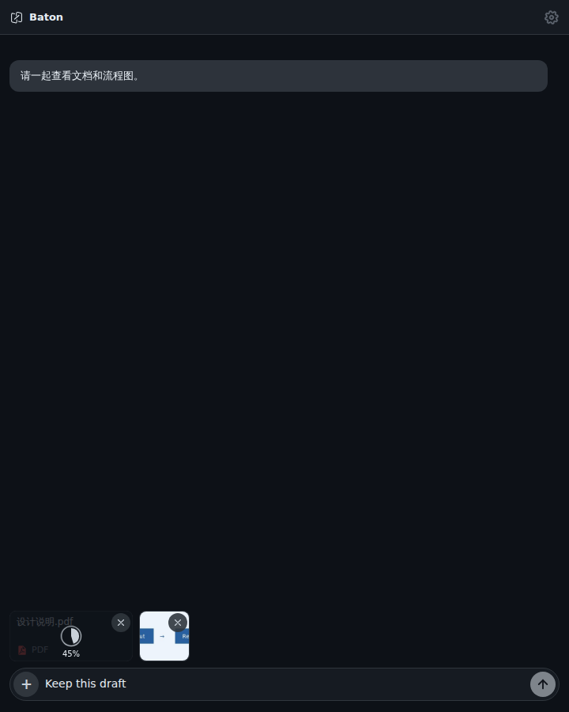

# macOS file drag-and-drop

Drop Finder files into a writable conversation or its composer. Files appear in
the existing attachment row; dropping does not send a message or change the text
draft. Uploads retain the conversation selected when the drop occurred, even if
the user navigates away while files are being inspected or uploaded.

The existing attachment controls show progress, retry failures and remove files.
Duplicate native delivery and repeated drops of the same file into that
conversation's staged attachments are ignored. Terminal, preview, modal and
read-only areas do not accept chat attachments.



This screenshot is Chromium rendering with synthetic native events and upload
transport. Attachment staging and browser image compression are real. It does
not demonstrate Finder, AppKit or a native HTTPS upload.

## Implementation and limits

- Native events grant access only to paths dropped into that window. Commands
  accept window-owned tokens, not arbitrary filesystem paths. Unclaimed tokens
  expire after 120 seconds; at most 256 outstanding grants are retained across
  windows. Removing attachments or destroying a window releases its grants.
- Regular files stream from disk and retain the existing 512 MiB upload limit.
  Directories must first be compressed into a ZIP. Changed files must be removed
  and dropped again.
- Supported image extensions up to 32 MiB use the existing browser compression
  and image-upload endpoint. Larger images follow the ordinary file path.
  Decoding still depends on the webview's supported formats.
- Ordinary native files use the server's existing random-key fallback rather
  than browser content hashing. Local duplicate suppression is not cloud content
  deduplication.
- Native uploads require HTTPS, reject embedded URL credentials and do not
  follow redirects. Cancellation stops subsequent reads; an HTTP request already
  waiting on its transport may take time to return.
- Staged attachments are kept in memory by server, device, project, conversation
  and runtime. They are not restored after a page reload.

This contribution does not require a Bridge or Server update.

## Verification

From the repository root:

```sh
npm ci
npm ci --prefix bridge
npm run test:frontend
npm run build
sh test/native/macos-drop-portable.sh
```

The portable Rust tests use the production command bodies with a Tauri host
shim. They cover grant ownership, single claim, expiry, filenames, folders,
size limits, changed files, streaming progress and cancellation. They do not
compile Tauri command macros, AppKit/WKWebView or the macOS TLS backend.

Native acceptance remains required on macOS:

1. Build and run this branch with the repository's usual macOS prerequisites
   and `npm run tauri -- dev`. Use a test conversation and the existing server
   connection.
2. Drop a document and image from Finder. Confirm progress, successful preview,
   one attachment per file, unchanged text draft and no automatic send.
3. Switch conversations while a larger file uploads. Return to the original
   conversation and confirm the attachments remain there.
4. Remove an uploading file; induce a connection failure and retry another.
   Confirm neither action duplicates a staged attachment.
5. Repeat in an additional window, on Retina display and with webview zoom.
   Confirm only the intended conversation/composer accepts the drop.
6. Confirm ordinary image/file picking and clipboard paste still work. Check
   folders, changed files, read-only conversations, terminal and preview areas.

Do not treat the portable tests or browser screenshot as native acceptance.
