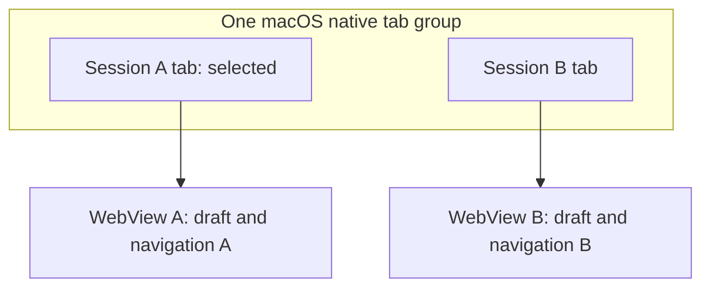

# Native macOS session tabs

A single macOS window can contain several Baton sessions in AppKit's native tab strip. Each tab remains a separate NSWindow/WebView with its own page, draft, navigation and connection; application credentials and shared settings retain their existing scope. New tabs open Home so another project or session can be selected.

This is a draft contribution. A real macOS tab-group screenshot and native interaction acceptance are still required. The diagram below explains the structure; it is not a device screenshot.



## Controls

- **Cmd+T / File → New Tab:** open Home in the current Baton tab group.
- **+ beside Settings:** the same action, scoped to the invoking window. A failed request can be retried; repeated clicks do not create duplicate requests.
- **Cmd+N / File → New Window:** keep a separate window, including when macOS prefers tabs automatically.
- **Window menu:** Merge All Windows, Move Tab to New Window, Show/Hide Tab Bar, Select Next/Previous Tab. Next/previous use Cmd+Shift+] and Cmd+Shift+[.
- Tab titles follow the current session name, project, new-session or Settings page. Titles are bounded and exclude control characters. Renaming one window's session does not update another window's title.

The standard Tauri menu is retained, including Edit and its clipboard shortcuts. NSWindow's visible titlebar hosts the native tab strip. Windows are built hidden, sized in logical points and inserted before presentation; group frame coordinates stay in AppKit so they are not confused with Tauri's physical/top-left coordinates. Closing a tab schedules cleanup of only that window's preview tunnels.

The explicit Cmd+T/+ actions are implemented here. AppKit's own optional tab-strip add button is not wired to Baton by this patch; its visibility and behavior must be checked during native acceptance.

## Validation

- Frontend: 609 passed, 1 existing skip, including 7 native-tab controller tests. Packaging: 31 passed. Vite build passed.
- Full Rust application: `cargo check --locked --target aarch64-apple-darwin` passed with Clang 18 for the Objective-C exception helper. This checks the actual AppKit/Tauri code and command registration; it does not link a Mac application bundle, create NSWindows or run the app.
- Actual Chromium at 480/1180 px with simulated native IPC: independent page titles, rename isolation, new-tab duplicate suppression, failure/retry, source draft and caret preservation, navigation snapshot restoration and Settings title. The ordinary 390 px browser has no native-tab control. No page errors; no horizontal overflow or collision with Settings.

```sh
npm ci
npm ci --prefix bridge
NODE_OPTIONS=--no-experimental-global-navigator node --test test/frontend/macos-tabs.test.mjs
npm run test:packaging
npm run build
cargo check --manifest-path src-tauri/Cargo.toml --locked --target aarch64-apple-darwin
```

## Required Mac acceptance

On macOS, build/run the app and capture a real native window showing two tabs with different session titles. Then verify:

1. Cmd+T and the toolbar + create a Home tab in the intended window. Cmd+N creates a separate window under each macOS tab preference.
2. Different tabs preserve their own drafts, selected sessions, connections and file previews. Switching and renaming do not target another tab.
3. Merge, detach, close, next/previous, tab-bar toggle, fullscreen and clipboard shortcuts work. Closing a tab releases its preview tunnels without stopping another tab's preview.
4. The group stays in place across Retina/non-Retina screens and the first tab insertion does not resize or jump the window.
5. Settings/back navigation updates the title, preserves the toolbar action and leaves the current draft intact.
6. Repeat with the drag/drop contribution: every newly created window must receive its drop handler. This standalone PR does not include #97; the shared window factory needs an explicit integration pass before combining them.

Window palettes remain a separate contribution to align with the maintainer's theme implementation. This PR does not change app identity, signing, theme, Bridge or Server, and does not install or deploy anything.
