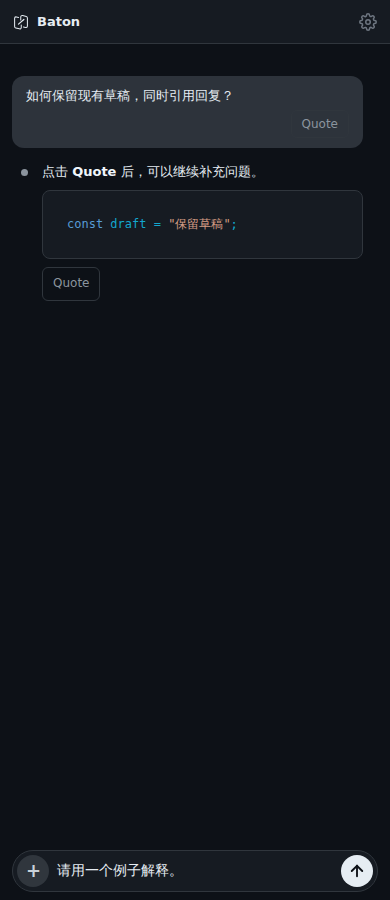
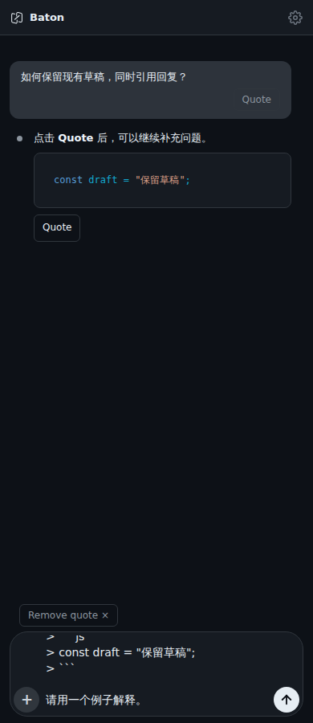

# Quote a message

Select **Quote** below a user or assistant message to put its text at the beginning of the current draft. Markdown and code in assistant replies are preserved. Add your question and use the normal Send button when ready; quoting never sends automatically.

Selecting another message replaces the unedited quote and keeps the rest of the draft. **Remove quote** removes that inserted text. If you edit the quoted text itself, it becomes ordinary draft text and the remove button disappears. After a page reload it is also ordinary saved draft text.

Tool output, thinking, attachments and command panels are excluded. While a reply is streaming, Quote captures only the text already revealed. The control is scoped to the active conversation; read-only threads and disabled composers cannot be changed.

These are real 390px Chromium screenshots using synthetic conversation content, before and after Quote. The textarea scrolls to the preserved draft for continued editing. They are browser evidence, not native-device screenshots.

| Before | After |
| --- | --- |
|  |  |
