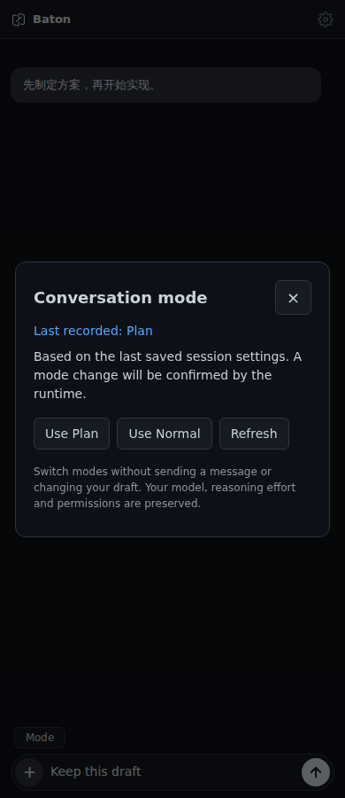
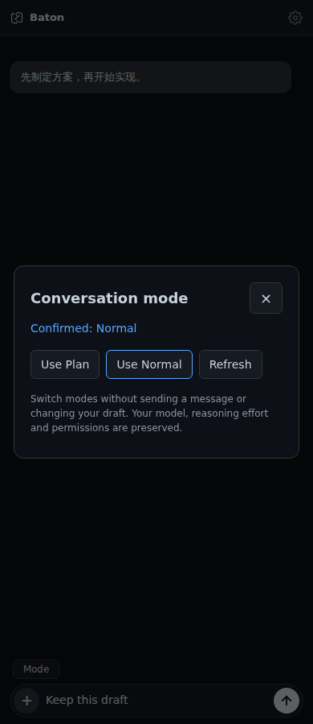

# Plan and Normal controls

Open an existing Codex conversation and select **Mode** above the composer.
**Use Plan** and **Use Normal** change that conversation's collaboration mode
without sending a message or replacing the draft. Model, reasoning effort and
approval/sandbox permissions are preserved.

Opening the panel only reads the thread and its latest saved settings. It does
not resume the thread, start a turn or take ownership from another terminal.
The label distinguishes **Last recorded** settings from a mode **Confirmed** by
the runtime after an explicit change. Missing saved settings are shown as
**Mode not reported**, rather than assuming Normal.

| Last recorded settings | Runtime-confirmed change |
| --- | --- |
|  |  |

These are 390px Chromium screenshots of the product interface with a synthetic
conversation and Codex runtime. The WebSocket, frontend dispatcher, Bridge mode
handler and `CodexInteraction` are real. They are not native-device screenshots.

## Requirements and boundaries

- Update both frontend and Bridge. The feature reuses the existing
  `list_command_options` / `command_options` route with `__baton_mode_v1`;
  no Server action is added. Older Bridges show an unsupported message.
- A compatible Codex App Server must expose `collaborationMode/list` and the
  experimental `thread/settings/update` / `thread/settings/updated` APIs.
  The actual runtime integration was checked with Codex CLI 0.160.0.
- Only existing Codex conversations expose the entry. Read-only conversations
  can be inspected; mode changes are disabled.
- Finish or stop a running turn before switching. Explicit changes resume the
  existing conversation but never terminate another terminal's writer.
- The mode write uses the fresh thread model and reasoning effort, falling
  back to the resume response on older runtimes. It does not set approval or
  sandbox policy. A settings acknowledgement alone is insufficient: the
  matching runtime notification must confirm the requested mode.
- Failures invalidate the displayed status and require Refresh before another
  write. An account/conversation change discards a pending UI result. Escape
  closes the panel before the global interrupt shortcut.
- A read is a bounded lookup of the last saved mode, not a guarantee that
  another client has not changed it since. Refresh repeats that read.

This contribution is independent of #93 (`/plan off`) and #96 (Goal controls).
It does not change command parsing, start/resume a Goal, or add model selection.
It shares the small RPC-dispatch and no-takeover support changes with #96.

## Validation

- Frontend suite: 611 passed, one existing native-rename skip.
- Bridge/Codex suite: 413 passed, including nine mode-control tests.
  Both full suites passed after rebasing onto main at `283dbf6`.
- Packaging: 31 passed. Vite production build passed.
- Real Chromium at 390px and 1180px: read, both switches, refresh, draft
  preservation, no extra user message, Escape, and no horizontal overflow.
- Actual Codex runtime: both directions confirmed using the product helper in
  an ephemeral thread, with model and effort preserved and no model turn.
- Actual `CodexInteraction`: one isolated read-only test conversation was
  initialized with a single short model response. Plan and Normal were each
  confirmed, then recovered from saved settings after closing and reopening
  the connection. The owned test conversation was archived.

Native keyboard/modal behavior and an installed App talking through a deployed
Server were not separately tested. No production service was changed.
